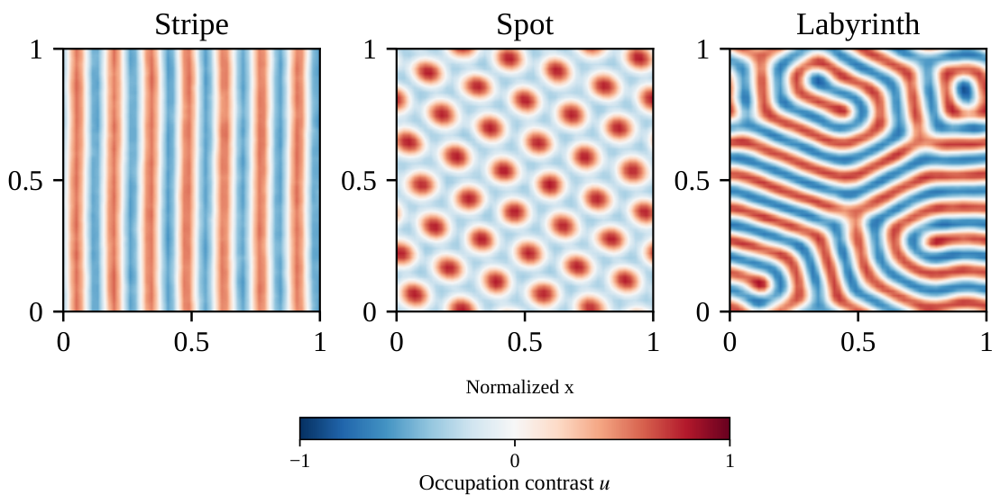
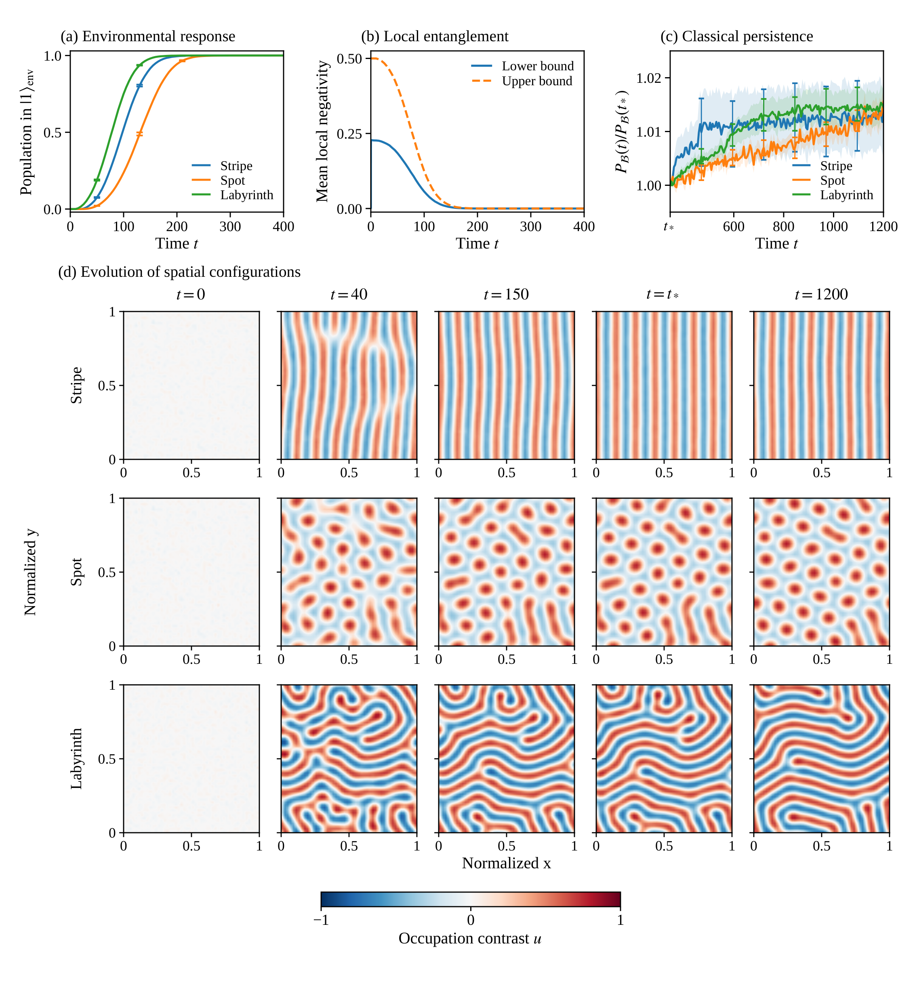

# Quantum self-organization and stabilization

**Local quantum entanglement as a resource for macroscopic spatial order.**

[](figures/README.md)

*Representative occupation-contrast configurations at t=600, shown on the same color scale. [Explore the figures](figures/README.md).*

Simulation code, numerical data and analysis tools for **Quantum entanglement as a resource for self-organization and stabilization**, by **Kazuki Ikeda**, University of Massachusetts Boston.

## Research overview

Can quantum entanglement generate macroscopic order that persists after the entanglement itself disappears? This study establishes such a mechanism in a driven-dissipative bosonic lattice. Entanglement between the two modes within each cell enables transport that amplifies spatial fluctuations into stripes, spots and labyrinths across the array.

The original model connects three aspects of this process:

- **Formation.** Quantum dynamics produces mean pattern intensities above rigorous bounds for all admissible separable evolutions under the specified physical constraints.
- **Stabilization.** Quantum evolution sustains pattern intensities above the separable maintenance bounds. Continuous number-basis projection, starting from the same occupation and leakage configurations, suppresses their persistence.
- **Control.** Increasing local dephasing suppresses pattern amplification. Restoring the original dephasing rate permits recovery.

The excess pattern intensity also gives a lower bound on the accumulated transport contribution beyond the separable limit. The simulations sample the exact invariant population jump process of the Lindblad model, and the entanglement criteria apply to the unconditional state of the physical modes. The separable bounds allow arbitrary classical correlations and the controls specified in [Methods](docs/METHODS.md).

## Autonomous classicalization

The [environmental extension](classicalization/) couples each cell to an environment that responds to emerging order by suppressing local coherence and activating classical transport. Quantum-supported formation, the environmental response and subsequent classical maintenance follow from a single time-independent Lindblad generator.

[](classicalization/figures/figure5_classicalization.pdf)

The patterns persist as local entanglement is lost. The reference time $t_*=345$ is the first common saved time at which all 48 baseline trajectories have completed the environmental transition. The generator remains unchanged at this time. Panel (c) shows ensemble averages of the individual band-power ratios $P_{\mathcal{B}}(t)/P_{\mathcal{B}}(t_*)$. The [model description](classicalization/docs/MODEL.md) explains the distinction between individual environmental records and the unconditional state, as well as the scope of the original separable bounds.

## Getting started

The [figures](figures/README.md) and [reference tables](data/reference/) can be inspected directly. The recorded validation environment uses Python **3.13.5** with versions pinned in `requirements-tested.txt`. See the [setup instructions](docs/SIMULATION.md#setup) for download and installation commands. A C++17 compiler is needed only for new simulations and generator tests.

## Reproduce the analysis and figures

From the repository root:

```bash
python analyze_trajectories.py --output results/analysis
python make_figures.py --analysis results/analysis --output results/figures
```

These commands regenerate Figures 1–4 and the overview image from the recorded trajectories. All realizations enter the ensemble averages. Figures, plotted values and input hashes are written under `results/`, separately from the supplied data. **No new stochastic simulation is required.**

<details>
<summary>Additional reproduction commands</summary>

Render Figures 1–4 from the included summary tables:

```bash
python make_figures.py --analysis data/summary --output results/figures
```

Regenerate the environmental analysis and Figure 5:

```bash
(
  cd classicalization &&
  python analyze_study.py &&
  python render_figure.py &&
  python validate_publication.py
)
```

The [environmental extension guide](classicalization/README.md) describes its additional checks and simulation options.

</details>

## Data

The original model includes **228 recorded trajectories**, with parameters, initial configurations and available event diagnostics. The [environmental extension](classicalization/) adds **172 trajectories**, for **400 in total**.

| Dataset | Contents | Trajectories |
| --- | --- | ---: |
| [`data/primary/`](data/primary/) | 48 formation runs and their matched quantum and number-projected continuations | 144 |
| [`data/preparations/`](data/preparations/) | Independent initial-field and disorder blocks, with matched continuations | 72 |
| [`data/dephasing/`](data/dephasing/) | Four suppression-and-recovery cycles for each pattern family | 12 |

The primary formation and maintenance ensembles use $48\times56$ cells and 16 realizations per family. Dephasing cycles use $24\times28$ cells. The independent-preparation analysis uses four preparation/disorder blocks as its statistical units.

The [data dictionary](docs/DATA_DICTIONARY.md) documents array axes, state labels, physical occupation numbers and metadata. It also explains the projected-state labels and the `energy` field, which denotes mean squared occupation contrast.

## Validation

The checks cover file integrity, parameter handling, all 216 formation and maintenance endpoints, 144 matched continuation starts, independent finite-system generators and short quantum and projected simulations. See the [validation guide](validation/README.md) for commands and recorded reports. Failed checks return a nonzero exit status. Checks for the [environmental extension](classicalization/README.md#reproducibility-and-scope) are documented separately.

## Run a simulation

```bash
python run_simulation.py confirm_stripe_00 --until 10 --output results/quantum_run
```

Omit `--until` for the full duration. The [simulation guide](docs/SIMULATION.md) covers projected runs, custom inputs, compiler selection and output formats. Existing outputs are not overwritten. Bitwise agreement of new trajectories depends on the compiler and random-number implementation.

## Repository guide

| Location | Purpose |
| --- | --- |
| [`qtp/`](qtp/) | Observables, separable bounds, geometry classification, analysis and plotting |
| [`src/critical_jump.cpp`](src/critical_jump.cpp) | Continuous-time quantum and number-projected jump dynamics |
| [`classicalization/`](classicalization/) | Autonomous environmental model, 172 trajectories, analysis and Figure 5 |
| [`figures/`](figures/) | Study figures, overview image and captions |
| [`docs/`](docs/) | Methods, data formats, analysis definitions and simulation instructions |
| [`tests/`](tests/) | Automated numerical and software tests |
| [`provenance/`](provenance/) | Generator and initialization hashes |

## Related work

The [Quantum Turing Pattern repository](https://github.com/IKEDAKAZUKI/Quantum-Turing-Pattern) contains related work on constructive quantum Turing pattern formation.

## Citation and permissions

Please cite **Kazuki Ikeda, “Quantum entanglement as a resource for self-organization and stabilization”**, and identify the repository version or commit used. Machine-readable software citation metadata is provided in [CITATION.cff](CITATION.cff).

Reuse and redistribution permissions are described in [LICENSE.md](LICENSE.md). Questions and reproducible bug reports can be submitted through the repository's issue tracker.
