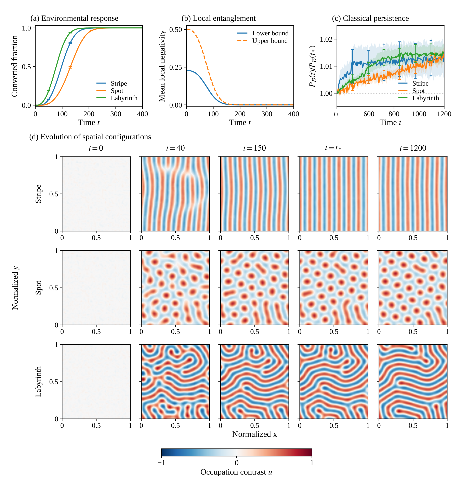

# Autonomous environmental classicalization

[](figures/figure5_classicalization.pdf)

A time-independent Lindblad extension of a bosonic dimer lattice in which local quantum coherence first supports spatial organization, an explicit environment responds to that organization, and the resulting order persists in a classical absorbing sector.

The primary simulations contain **no externally timed parameter switch and no imposed continuous projection**. Environment-induced number-state recording, local pump shutdown, and classical transport activation are fixed jump channels of the enlarged system. All reported results are generated from the included code and trajectories.

## Results

The baseline study uses a 48 × 56 lattice, three parameter families, and 16 independent weak initial fields and disorder realizations per family. All 48 autonomous runs reach the fully converted environmental sector by time 341 and continue to time 1200. The persistence reference $t_*$ is the first common saved time at which all 48 baseline environmental records are fully converted. Here $t_*=345$, following the last recorded conversion event at $t=340.7600787$. At $t=1200$, mean power retention is $101.37\pm0.61\%$, $101.56\pm0.25\%$, and $101.45\pm0.32\%$ for stripes, spots, and labyrinths, respectively. These are means of individual $P_{\mathcal{B}}(t)/P_{\mathcal{B}}(t_*)$ ratios, with one standard error. No parameter changes at $t_*$. The final morphology matches the target in 16/16 stripe, 15/16 spot, and 15/16 labyrinth realizations. The two other outcomes retain spatial order but change morphology. No trials are discarded.

Additional runs include 48 quantum-channel-removal controls, 48 controls without activated classical gain, four exact number-projected controls, three environment-disabled references, six initially coherent runs, and 15 parameter variations. There are **172 completed runs** in total. The baseline quantum-channel-removal controls do not activate the environment during the observation interval. Suppressing the converted environment's classical gain removes the sustained pattern after classicalization.

These are results for a constructed active-environment model. Finite-time trajectory conversion is not a proof of a thermodynamic phase transition or of exactly vanishing unconditional entanglement at a prescribed finite time. The fully converted environmental sector is rigorously separable and invariant. Residual unconverted probability gives a quantitative upper bound on local negativity and vanishes asymptotically. See [the model](docs/MODEL.md).

## Start here

- [Model, Lindblad operators, and classicality](docs/MODEL.md)
- [Publication figure](figures/figure5_classicalization.pdf)
- [Plotted numerical values](figures/figure5_values.csv)
- [Completion times and reference definition](analysis/reference_time.json)
- [Numerical summaries](analysis/results.json)
- [Per-run results](analysis/endpoints.csv)
- [Validation](validation/data_checks.json)

## Installation

Python 3.10 or later and a C++17 compiler are required. The simulations are CPU based.

```bash
python -m venv .venv
source .venv/bin/activate
python -m pip install -r requirements.txt
mkdir -p build
g++ -O3 -std=c++17 src/autonomous_jump.cpp -o build/autonomous_jump
g++ -O3 -std=c++17 src/projected_control.cpp -o build/projected_control
```

On Windows, activate the environment with `.venv\Scripts\activate` and use a C++17 compiler available on the system. A POSIX environment such as WSL can run the commands above directly.

## Regenerate analyses and the publication figure

No simulation is needed to regenerate the results from the included trajectories.

```bash
python analyze_study.py
python render_figure.py
python validate_data.py
python validate_quantum_generator.py
python validate_rates.py
```

The uncertainty in the main curves is one standard error over the 16 realizations within each family. The Fourier band and morphology thresholds are fixed. The representative images use the lower-median final-power realization of each family, without filtering by morphology. The selected identifiers, map hashes, plotting settings and input hashes are recorded in `figures/figure5_provenance.json`.

## Run a new experiment

Use a new tag to keep generated results separate from the supplied trajectories.

```bash
python run_study.py --tag repeat --protocols autonomous \
  --replicates 16 --duration 1200 --workers 4

python run_study.py --tag coherent_start --protocols autonomous \
  --replicates 2 --duration 1200 --overrides '{"m0": 0.91}'

python run_study.py --tag projected_repeat --protocols projected_control \
  --replicates 1 --duration 1200
```

The other supported protocols are `no_quantum`, `no_classical_gain`, `no_environment`, and `classical_ready`. A protocol changes the generator or initial state before the simulation begins. It does not schedule a change during a trajectory. Existing completed runs are not overwritten.

`src/projected_reference.cpp` is a direct sign-enumeration reference for the exact projected control. Two included stripe controls used this implementation; their parameter files retain its source hash. `src/projected_control.cpp` omits zero sign coefficients and uses an algebraically identical square-root calculation. Their rates agree to floating-point precision in the supplied independent check.

## Data layout

Each `trajectories/*_params.json` contains physical parameters, initial-state provenance, and the generator-source hash. Its `.npz` file contains:

| Array | Meaning |
|---|---|
| `t` | Saved observation times |
| `n` | Centered integer occupation labels, shape `(time, ny, nx)` |
| `s` | Relative-phase label ±1 or leakage label 0 on unconverted cells; nonleaked label 1 or leakage label 0 on converted cells |
| `h` | Environmental flag, 0 before and 1 after irreversible conversion |
| `eps` | Occupation contrast step |

The physical field is `u = eps * (n - 0.5*(s == 0))`. For a converted cell, `s=1` does **not** mean nonzero coherence. Its physical state is an incoherent number-state mixture. Local coherence is `(1-h)*s` in the primary quantum runs and identically zero in the classical controls.

The accompanying CSV contains scalar observations. `_events.csv` records the time, site, and local-activity or propagation cause of every environmental conversion. `_engine.json` contains event counts and numerical consistency checks.

## Reproducibility and scope

The simulation is an exact Gillespie sampling of the invariant hybrid-basis population process. There is no finite integration step. `validate_quantum_generator.py` independently checks this reduction against a 32-dimensional density-matrix generator, including every population-basis derivative. `validate_rates.py` checks 8,192 projected-rate cases. `validate_data.py` checks all 172 trajectories, source hashes, irreversible environmental records, and classical-sector invariance.

No occupation cutoff is reached in the 48 baseline autonomous runs. The high-classical-gain labyrinth parameter check has five cutoff events; it is retained and identified in the validation record.

The original fixed-channel separable bounds do not apply unchanged after adding these environmental channels. The quantum-free controls establish a contrast over the simulated interval, not a theorem excluding arbitrarily late noise-induced activation.

## Attribution

The baseline bosonic-lattice parameters and morphology routines come from Kazuki Ikeda's **Quantum entanglement as a resource for self-organization and stabilization** and its accompanying research code. The environmental channels and the simulations in this archive are an additional construction. Rights and permissions are described in [LICENSE.md](LICENSE.md).
