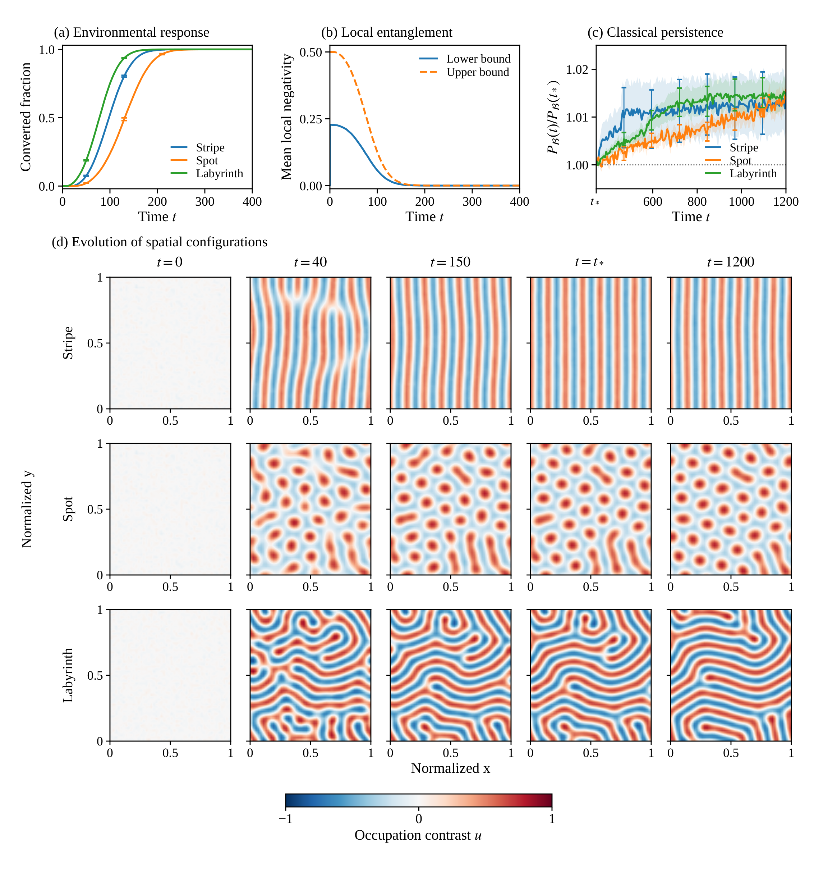

# Autonomous classicalization

The four panels show environmental conversion, local-negativity bounds, persistence after conversion, and representative spatial configurations. The PDF preserves vector text and curves. All heatmaps share the same blue–white–red scale, from -1 to 1.

The reference $t_*$ is the first common saved time when all 48 baseline environmental records are fully converted. For these data, $t_*=345$. It is a measured completion reference, not an externally imposed switching time.

`figure5_values.csv` contains the plotted means, standard errors, and entanglement bounds. `figure5_provenance.json` records the source data hashes, selected trajectories, and normalization. Regenerate with `python render_figure.py` from the `classicalization` directory.
