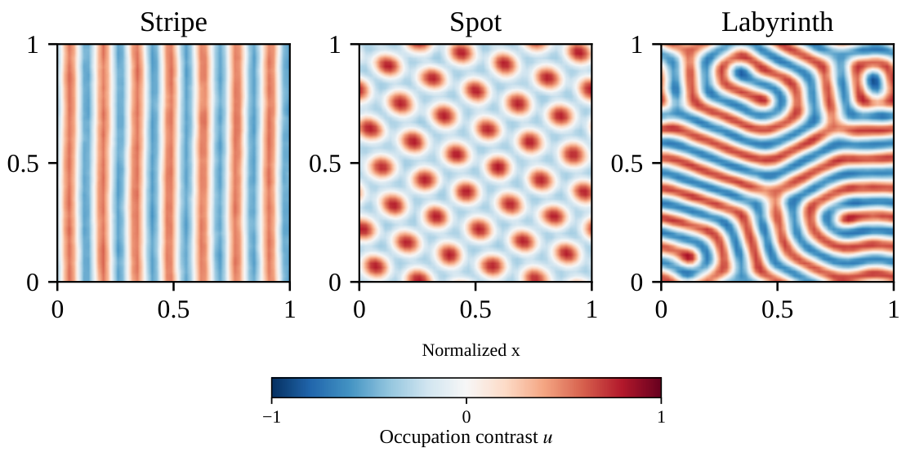
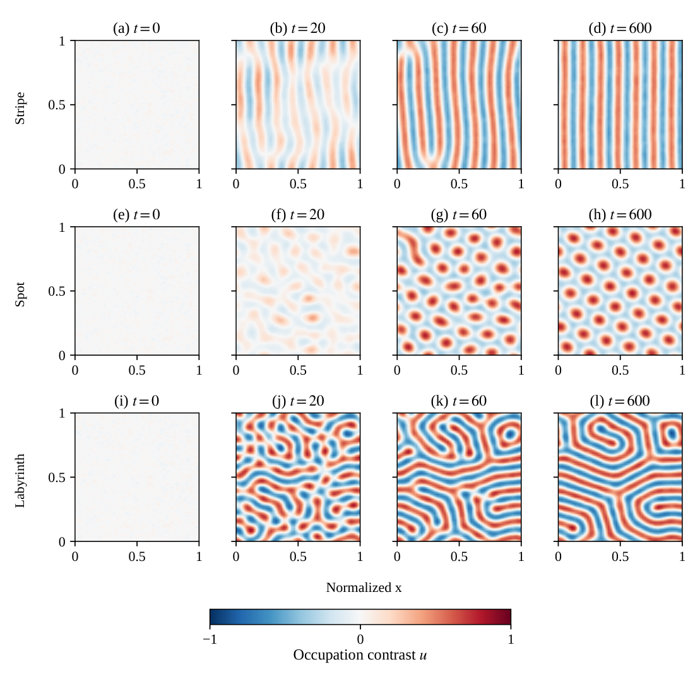
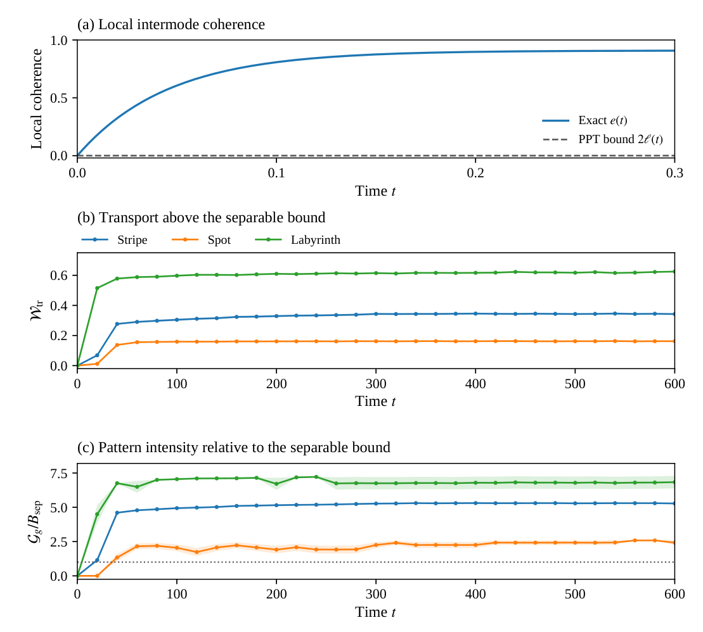
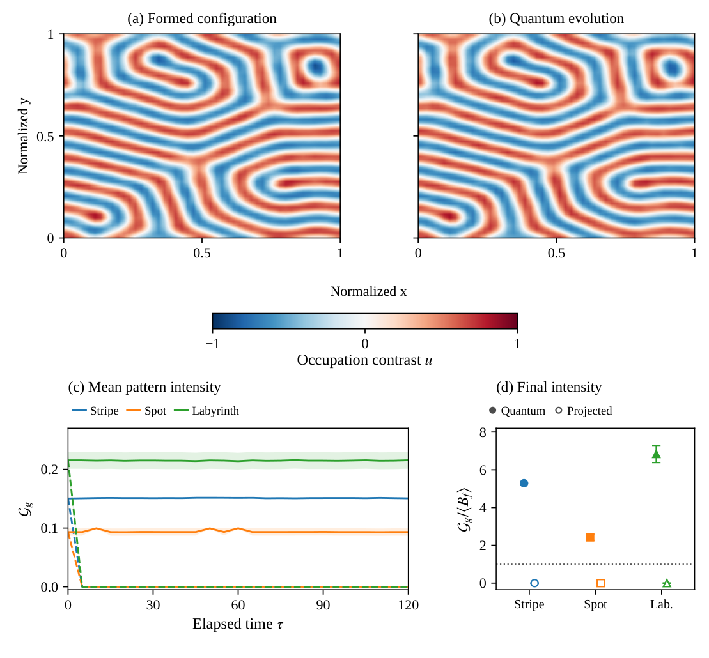
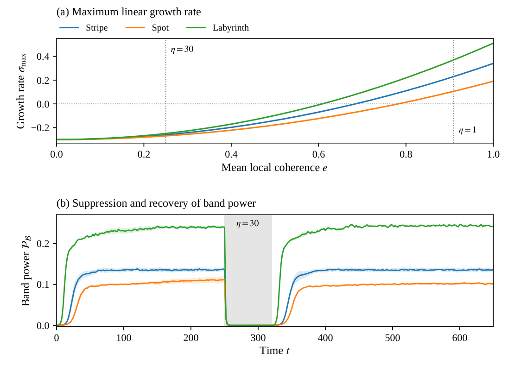

# Figures

The figures use the recorded trajectories, ensemble statistics and model equations. PDF files retain vector text and curves; PNG files provide browser previews. All heatmaps share the occupation-contrast scale $[-1,1]$ and normalized coordinates. Display interpolation does not enter the numerical analysis.

## Research overview

[](research_overview.pdf)

Representative stripe, spot and labyrinth configurations at $t=600$. These are the final snapshots of the same realizations shown in Figure 1.

## Figure 1 · Pattern formation

[](figure1_formation.pdf)

Formation of stripe, spot and labyrinth patterns, shown in the top, middle and bottom rows. Each row follows one realization at $t=0,20,60,600$. All panels share the occupation-contrast scale and normalized spatial coordinates.

## Figure 2 · Entanglement and spatial order

[](figure2_resource.pdf)

From intermode coherence to extended patterns. (a) Exact source coherence $e(t)$ and the separability bound $2\ell(t)$ on the local relaxation scale. (b) The transport diagnostic $\mathcal{W}_{\mathrm{tr}}$, positive when transport exceeds the local separable bound. (c) Mean pattern intensity divided by the formation bound, with equality marked by the unit line. Shading in (b,c) gives one standard error of the mean.

## Figure 3 · Pattern stabilization

[](figure3_maintenance.pdf)

Pattern persistence from the same initial occupation configurations. (a) A labyrinth at $t_f=600$ and (b) the same realization after quantum evolution to $\tau=120$, on a common contrast scale. (c) Mean pattern intensity under quantum (solid) and number-projected (dashed) evolution. Bands show one standard error of the mean. (d) Mean pattern intensity at $\tau=120$ divided by the mean maintenance bound for the starting configurations. Error bars give the standard error of the mean intensity divided by that mean bound. The unit line marks the separable bound.

## Figure 4 · Dephasing control

[](figure4_control.pdf)

Control of Turing amplification and recovery of band power. (a) Maximum linear growth rate near $u=0$ in the homogeneous deterministic limit with rapid phase relaxation. Vertical lines mark stationary values of the local coherence at $\eta=1$ and $30$. (b) Mean band power under the finite-dephasing cycle. Shading gives one standard error of the mean. The dephasing rate is $\eta=30$ in the gray interval $250\leq t<320$ and $\eta=1$ otherwise. The band power returns close to its pre-dephasing level for all three parameter sets.

## Recreate these figures

From the repository root:

```bash
python analyze_trajectories.py --output results/analysis
python make_figures.py --analysis results/analysis --output results/figures
```

The figure inputs and statistical conventions are specified in [Analysis details](../docs/ANALYSIS_DETAILS.md). Times-compatible serif typography uses an installed Tinos, Times New Roman or Nimbus Roman font, with the system serif fallback when none is available. Font files are not included.
